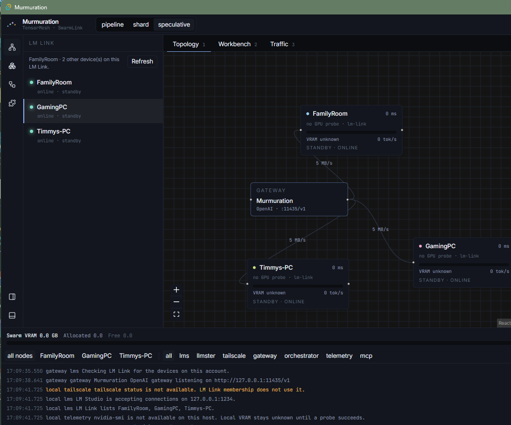
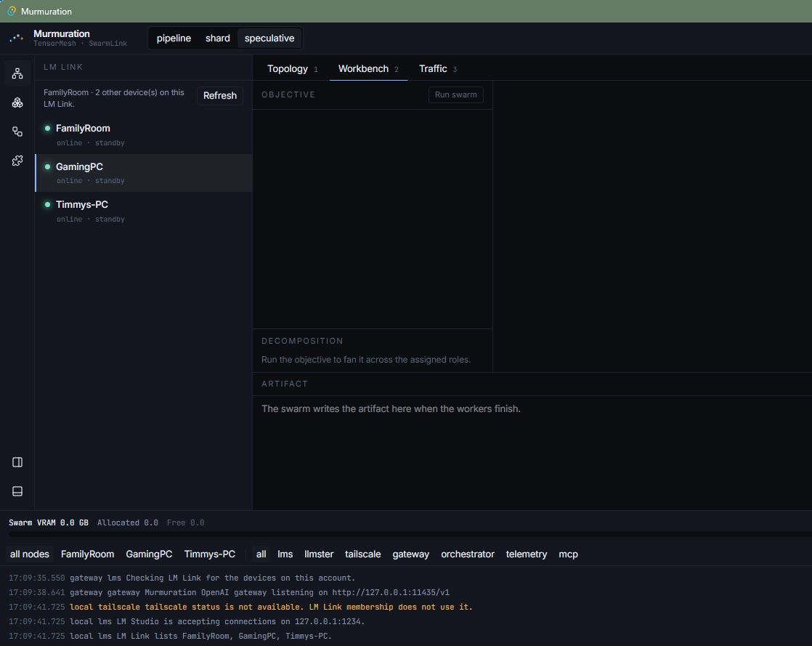
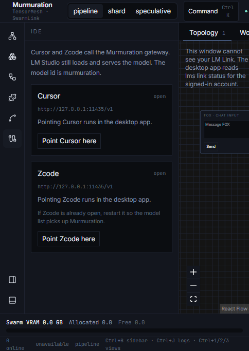
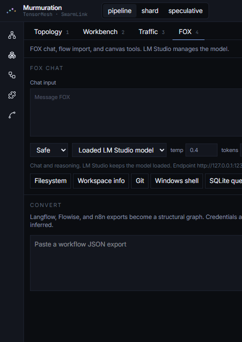
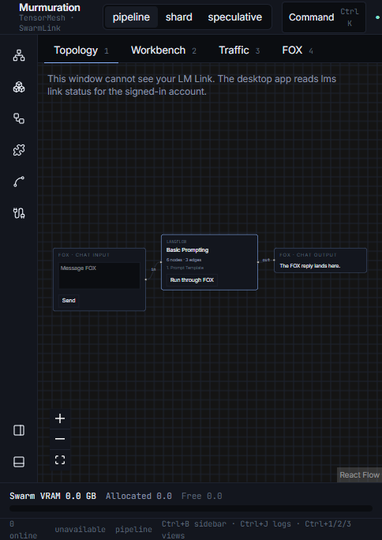
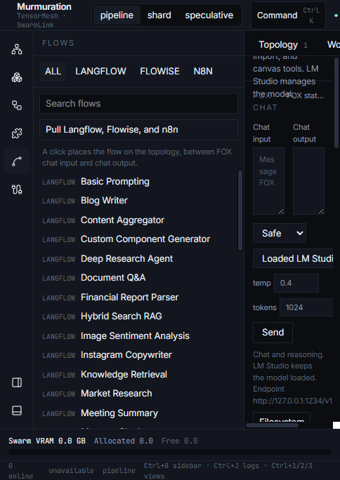

# Murmuration

Murmuration is a desktop studio for a mesh of LM Studio machines. TensorMesh is the orchestrator. SwarmLink is the path between them: LM Studio LM Link, with Tailscale used only when it is installed and only as extra address information.

The node list is the signed-in LM Link. `lms link status` names this device and the other devices on that account. Machines that are not on the link are left off the list. Nothing in that filter deletes model files on disk.



The screenshot above is the desktop app on a real account. FamilyRoom is this computer. GamingPC and Timmys-PC are the other devices LM Link reported. The gateway bearer token is not in the picture.

## What you can do from the window

The studio is four zones.

| Zone | What it shows |
| --- | --- |
| Left | LM Link devices, the model registry, swarm blueprints, extensions, the flow catalog, and IDE clients |
| Center | Topology (LM Link machines, FOX chat nodes, and clicked flows), the workbench, the traffic inspector, and FOX chat |
| Right | Decode settings and local MCP tools |
| Bottom | Combined VRAM and logs from lms, the gateway, and discovery |



Each LM Link row shows whether the device is online, whether it is this computer, and whether it is the preferred device. A row also shows measured VRAM when a GPU probe returns it, or the configured or inferred size when that is what ranking uses. CPU, GPU, and RAM appear on the row after you save them. The search box under Refresh matches the device name, status, role, CPU, GPU, and those sizes. Refresh asks `lms link status` again.

The workbench takes one objective, splits it across roles, and keeps the resulting artifact editable. The traffic tab records the routing decision, time to first token, and whether the reply came from a live LM Studio or from the orchestrator brief.

The command palette is Ctrl+K (Cmd+K on macOS). Ctrl+B toggles the sidebar, Ctrl+J toggles the log dock, and Ctrl+1 through Ctrl+4 switch the center tabs. Ctrl+4 opens FOX.

## Cursor and Zcode

The IDE activity points Cursor and Zcode at the gateway on this machine. The model id is `murmuration`. LM Studio still loads the weights. **Point Cursor here** writes the OpenAI base URL into Cursor's user settings and leaves every other setting in that file alone. **Point Zcode here** adds a Murmuration provider to `~/.zcode/v2/provider_config.json` on the OpenAI chat protocol, and leaves any other provider in that file alone. If Zcode is already open, restart it so the model list reloads.



The picture is the studio. The preview cannot write those files, so the cards say the desktop app does. The gateway bearer token is not in the picture.

## FOX chat

FOX is the advisor on the fourth center tab. Chat input and chat output are also nodes on the topology, and both places share the same text. Send writes the reply into chat output. LM Studio at `http://127.0.0.1:1234/v1` is the runtime that loads and serves the model. FOX does not start another server and does not switch the loaded model.

Safe, Power, and Vision only change the system prompt. Temperature and the token cap sit on the FOX tab. The nine tool chips name which T.I.M. tools the prompt may mention. Running a tool is still a separate click on the tool card, and the Windows shell, HTTP fetch, and MCP bridge stay off until you approve that run.

A reasoning model can leave the visible `content` field empty and put the reply in `reasoning_content`. Murmuration shows that text as the chat output. A long reply waits up to 180 seconds plus a quarter of the token cap, and never longer than 10 minutes.



## Imported flows

The Flows activity opens the catalog. A click places that flow on the topology as one node, between the FOX chat input and the FOX chat output. The edge into the flow carries the prompt. The edge out of the flow carries the reply. **Run through FOX** sends the chat input through that flow's steps to the model LM Studio has loaded. The reply shows in chat output on the topology and on the FOX tab. Another click adds another flow on the same path. The highlighted flow is the one Run uses.

Langflow and Flowise starters ship in the app. The n8n list is an index; opening an entry fetches that workflow from the allowlisted raw GitHub URL. You can also paste an export. Credentials in the JSON are dropped and called out. The conversion is structural: the export becomes one runnable node, and brain or tool edges are not invented.

The shell tool runs `cmd.exe` in the workspace, with no console window, and stops after 20 seconds. Paths stay under the workspace. SQLite is one read-only `SELECT`. Agent memory is a JSON file under `%LOCALAPPDATA%\Murmuration`.



The picture is the studio after a click on Basic Prompting. Chat input, the flow, and chat output sit on one path. This preview has no LM Link devices, so the note at the top says the desktop app is what reads the account. On that app the machines stay on the same canvas. The gateway bearer token is not in the picture.

The catalog stays in the sidebar while you pick another flow.



## Run it

Requirements: Node 20, Rust, and the Tauri prerequisites. LM Studio supplies the device list. A GPU probe uses `nvidia-smi` when that command exists.

```bash
npm install
npm run tauri dev
```

`npm run dev` opens the browser preview only. That preview cannot run `lms`, so the node list stays empty there and says so. The desktop shell is what reads LM Link.

A release build without an installer:

```bash
npm run tauri build -- --no-bundle
```

The executable is `src-tauri/target/release/tensormesh.exe`. The window title is Murmuration.

## Point a client at the mesh

The gateway binds to loopback only, on port 11435, and walks forward to 11444 if that port is taken. The title bar shows the port that opened.

```text
http://127.0.0.1:11435/v1
```

Use the model id `murmuration`. The IDE activity writes that URL for Cursor and for Zcode, as shown above. Continue and other OpenAI-compatible clients can use the same URL by hand.

| Route | Behavior |
| --- | --- |
| `GET /v1/models` | The virtual Murmuration model plus the catalog |
| `POST /v1/chat/completions` | Routed to a live LM Studio when one is up, otherwise an orchestrator brief |
| `POST /v1/embeddings` | A small local lexical vector, labeled as such |
| `GET /metrics` | Prometheus text for the swarm |
| `POST /mcp` | Local tools. Requires the bearer token shown in the inspector |

Chat completions that reach a live LM Studio are proxied. If that hop fails, the gateway logs the failure and answers with the orchestrator brief instead of pretending the peer ran.

## How a device gets onto the list

Membership comes from one command:

```bash
lms link status --json
```

The desktop app parses that JSON. This device stays first. Every peer in the payload is added, including a peer that was missing from the previous list. A device that is not in the payload is removed from the window. Simulated demo machines are not members and are not shown.

The command does not include GPU memory. Effective VRAM is chosen in three steps, and a higher step wins a tie:

1. **Measured.** `nvidia-smi` on this PC, or a peer `GET /metrics` payload.
2. **Configured.** A VRAM number you save in the inspector, or `vramGb` in `mesh.manifest.json`. A number you save replaces the manifest value for that device name. Saving a blank VRAM field clears it.
3. **Inferred.** The footprint of models loaded by `lms ps`, a loaded LM Link model size, or the largest local GGUF.

An online device with a measured, configured, or inferred size stays in the role ranking. A device whose three sizes are all zero stays on standby. A stress injection with no utilization sample drives synthetic tokens per second and does not mark the real device throttled.

`nvidia-smi` is resolved from `PATH`, then `C:\Windows\System32\nvidia-smi.exe` and `C:\Program Files\NVIDIA Corporation\NVSMI\nvidia-smi.exe` on Windows, or `/usr/bin/nvidia-smi` and `/usr/local/nvidia/bin/nvidia-smi` on Linux. The query reads `memory.total`, `memory.free`, and `utilization.gpu`.

Copy `mesh.manifest.example.json` to `mesh.manifest.json` to name a sidecar host. The default port is 9471. `MURMURATION_MESH_MANIFEST` and `MURMURATION_TELEMETRY_PORT` override the file.

On each other PC:

```bash
python telemetry_sidecar.py --port 9471
```

`GET /metrics` returns `vram_total_mb`, `vram_free_mb`, `gpu_util_pct`, and `gpu_count`. Use the sidecar only on a LAN you trust. A missing `nvidia-smi` returns zeros and HTTP 200, and Murmuration treats a zero total as no measurement.

If `lms link status` cannot be read, the list does not invent peers. It shows the error and keeps any devices already confirmed on the link.

## Hardware you type in

Select a device. The inspector has four fields: VRAM GB, RAM GB, CPU, and GPU. **Save hardware** stores them by device name in `%LOCALAPPDATA%\Murmuration\hardware.json` on Windows, or `~/Murmuration/hardware.json` elsewhere. `MURMURATION_HARDWARE_FILE` points at a different file. Rediscovery keeps the saved values, including for a device that is offline when you next open the app.

Saved VRAM is the configured size in the ranking above. RAM, CPU, and GPU are labels. They show on the device row and are included in search. The search box is case-insensitive. Every word has to match. An empty search shows the whole link. If devices are listed and none match, the pane says **No devices match.**

```json
{
  "nodes": [
    { "hostname": "FamilyRoom", "vramGb": 24, "ramGb": 64, "cpu": "Ryzen 9 7950X", "gpu": "RTX 4090" }
  ]
}
```

## Routing, VRAM, and sharding

Three modes change how a prompt is placed:

- **Pipeline** sends the architect, coder, and critic steps to different devices when those roles are healthy.
- **Shard** computes a layer placement and reserves VRAM for it. Weights are not split across machines until you set an `http` or `https` shard backend, such as a llama.cpp RPC server. The log says when the map is only a plan.
- **Speculative** prefers a smaller device as the draft and a larger one as the target.

Before a mount, the fit calculator estimates weight, KV cache, and scratch against the pool. KV size grows with context length and with the cache quant (fp16, q8, or q4). If the pool cannot hold the model, commit is rejected.

A node that is offline, sleeping, or thermally throttled is skipped. The next prompt fails over, and the inspector shows which device was skipped.

## MCP tools

`POST /mcp` on the gateway requires `Authorization: Bearer <token>`. The token is generated when the app starts and is shown only in the inspector.

| Tool | What it does |
| --- | --- |
| `swarm_status` | Current nodes, mode, and gateway |
| `files_read`, `files_write` | Paths must stay under the project root you set |
| `shell_exec` | Stays off until a project root is set and the shell is armed |
| `vector_query` | Lexical overlap over the catalog, recent logs, and recent traffic |
| `web_search` | Uses `TENSORMESH_SEARCH_URL` when that environment variable is an http(s) endpoint. Otherwise it returns local hits and says search is not configured |

Exit-node changes and git worktree commits both require an explicit confirm. The worktree helper refuses paths that contain `..`.

## Extensions

Three built-ins ship as SwarmPlugin manifests:

- **Prometheus exporter** copies the metrics text and shows the scrape URL.
- **Smart context compressor** summarizes the current objective onto the smallest warm device.
- **Git worktree auto-committer** writes an artifact into a worktree only after you confirm.

A tiny WebAssembly probe in the extensions panel reports its module name. It does not load remote code.

## Layout

```text
src/                  React studio
  components/         Activity bar, LM Link list, topology, workbench, FOX, IDE clients, inspector
  lib/                Browser-side mesh, fit math, gateway client, T.I.M. converters
catalogs/             Langflow and Flowise starters, plus the n8n index
src-tauri/src/        Discovery, telemetry, fit, orchestrator, gateway, MCP, FOX, IDE clients, tools
extensions/           SwarmPlugin manifests
docs/images/          README screenshots
telemetry_sidecar.py  Zero-dependency GPU metrics server
mesh.manifest.example.json
```

Rust tests cover LM Link filtering, the three VRAM tiers, nvidia-smi path lookup, the metrics JSON shape, synthetic stress without a GPU sample, saving hardware by device name, FOX replies that arrive as reasoning text, the GitHub allowlist for imported workflows, and the Cursor and Zcode config writers. Unrelated settings and other Zcode providers stay.

```bash
cargo test --manifest-path src-tauri/Cargo.toml
```

## What this build does not do

- It does not download weights or call `lms load` unless you mount a real local file and the command is allowed to run.
- It does not split tensors across the network unless the shard backend URL is set.
- It does not change Tailscale exit nodes unless you confirm that action.
- The browser preview is not a second source of devices. It waits for the desktop shell. FOX chat in that preview says it runs in the desktop app.
- FOX does not load a model, and it does not talk to KoboldCpp or a llamafile. LM Studio on port 1234 does the serving.
- Imported graphs do not replay the original Langflow, Flowise, or n8n runtime. A click turns the export into one topology node, and Run sends that prompt through LM Studio.
- The IDE buttons write Cursor and Zcode config on this machine. They do not sign you into those apps, and they do not switch the model LM Studio has loaded.
